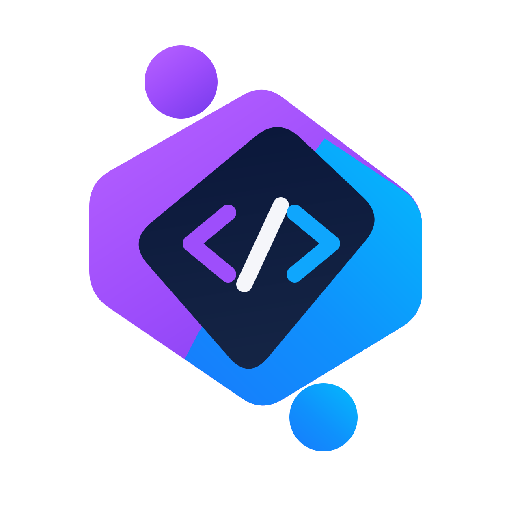

<div align="center">
  <a href="https://editwith.me" target="_blank" rel="noopener">
    
  </a>
  <h1>EditWithMe</h1>
</div>

<h4 align="center">
  <a href="https://editwith.me">Live app</a> |
  <a href="#quick-start">Quick start</a> |
  <a href="#mcp--let-an-ai-edit-a-document">MCP</a> |
  <a href="docs/custom-domain-setup.md">Deployment</a>
</h4>

<div align="center">
  <h2>
    An open-source collaborative HTML document editor. </br>
    Local-first, peer-to-peer, and access by capability link — no accounts, no database required. </br>
  </h2>
</div>

<div align="center">
  <a href="https://editwith.me"></a>
  
  
  
  
</div>

## Features

- 📝 **Edit any HTML visually** — open a blank page or import an `.html` file; the document's own CSS, fonts, tables and inline SVGs are preserved untouched, in the editor and on export.
- 🤝 **Real-time collaboration** — Google-Docs-style editing with live cursors and presence, backed by a **Yjs CRDT** so concurrent edits merge conflict-free.
- 🛰️ **Peer-to-peer, no WebSocket** — editors sync over a WebRTC mesh; the server is a stateless "archivist" reached only by HTTP checkpoints. The whole backend scales to zero.
- 🔌 **Offline-first** — every document lives in IndexedDB; edit offline and everything merges on reconnect.
- 🔑 **Capability-URL access** — no accounts and no admin password. A document's link *is* the permission: `…/<id>/<key>` edits, `…/<id>` is view-only.
- 💬 **Comments & highlights** — margin comments with edit history, press-and-hold highlight colors.
- 🕓 **Version history** — automatic snapshots you can browse and restore.
- 🖨️ **Export** — download the `.html` or a faithful **PDF** (headless Chrome, print styles and external fonts intact).
- 🤖 **AI-editable over MCP** — hand an agent a per-document connector URL and it can resolve comments and apply targeted edits, live, alongside your team.

## editwith.me

The hosted app at **[editwith.me](https://editwith.me)** runs the code in this repo on Google Cloud (Cloud Run, scale-to-zero). It is:

- **Local-first** — a document is created in your browser the instant you open the app and works with no network at all.
- **Peer-to-peer** — editors exchange changes directly over WebRTC; signaling is WebSocket-free (Firestore listeners in production, HTTP polling in dev) and the room is keyed by a hash of the edit key, so nothing leaks the document id.
- **Capability-secured** — the URL is the grant. There is no listing endpoint; nothing enumerates documents or keys.

## Quick start

```bash
pnpm install
pnpm dev            # http://localhost:3000
```

That's it — no cloud account needed. Dev uses local storage (`sqlite` or file-backed objects) and the HTTP polling signaling transport, so collaboration works fully offline on one machine (open two tabs).

```bash
pnpm generate:api   # regenerate the orval HTTP client after editing openapi.yaml (already committed)
pnpm build          # production build
```

Optional environment (`apps/web/.env.local`):

| Variable | Purpose |
| --- | --- |
| `STORAGE_DRIVER` | `sqlite` (default) or `objects` (GCS-style store) |
| `GCS_BUCKET` / `GOOGLE_APPLICATION_CREDENTIALS` | real bucket for the `objects` driver (omit `GCS_BUCKET` → local files under `data/objects`) |
| `FIREBASE_API_KEY` / `FIREBASE_PROJECT_ID` | enable the Firestore signaling transport in production |
| `CLOUDFLARE_TURN_KEY_ID` / `CLOUDFLARE_TURN_API_TOKEN` | TURN relay for NAT-blocked peers (else STUN-only) |
| `APP_PUBLIC_URL` | public origin used in links the MCP tools produce |

## Repository

**pnpm + Turborepo** monorepo:

| Package | Description |
| --- | --- |
| `apps/web` | Next.js (App Router) — editor, REST + sync + signaling + MCP routes, storage layer, WebRTC mesh. UI: **shadcn/ui + Tailwind v4** with a liquid-glass chrome. |
| `packages/db` | SQLite access (`better-sqlite3`) for the default storage driver. |
| `packages/editor-schema` | TipTap extensions shared by the browser editor and the server (HTML ⇄ CRDT): attribute & semantic-tag preservation, verbatim inline SVG, comment marks, tab indent. |

## How sync works (P2P + archivist)

No persistent connection to the server exists:

- **Editors** form a WebRTC mesh (raw `RTCPeerConnection` + y-protocols; deterministic offer roles, so no glare). Handshakes are AES-GCM encrypted with the edit key — the mesh is editors-only.
- **Signaling** is WebSocket-free behind one interface: Firestore listeners (push, free-tier) in production, HTTP polling in dev. The Firestore path is keyed by `roomId = SHA-256(editKey)`, never the document id; clients never delete signaling docs (TTL reclaims them).
- An elected **leader** checkpoints CRDT diffs to `POST /api/documents/{id}/sync`; the server merges (commutative, race-tolerant) and materializes HTML **on read**.
- **Viewers** and mesh-less editors converge by polling cheap state-vector diffs — which is also how out-of-band AI/MCP revisions reach live editors (~30s).

The `objects` storage driver is the serverless pairing: append-only immutable log objects + CAS-guarded compaction in a GCS-style bucket (`docs/{id}/…`), with automatic version snapshots under `docs/{id}/versions/`.

## MCP — let an AI edit a document

The app serves a **per-document** MCP endpoint (Streamable HTTP): `/api/mcp/doc/<id>/<editKey>`. The URL is the capability — an agent added with it can read and edit **only that document**. Paste it into claude.ai as a custom connector, or:

```bash
claude mcp add --transport http editwithme "https://editwith.me/api/mcp/doc/<id>/<editKey>"
```

The **AI Connect** button in the editor shows the URL and setup steps. Tools (scoped to the one document): `read_document`, `read_for_revision` (comments as a task list), `resolve_comment`, `edit_document` (targeted find-and-replace, applied as a minimal CRDT delta), `update_title`. There is deliberately no whole-document-rewrite tool and no cross-document / listing / delete surface.

## Deployment

`infra/` is Terraform for Google Cloud: Cloud Run (scale-to-zero), a GCS bucket, Firestore (signaling) with hardened rules + TTL, a restricted browser API key, and least-privilege IAM. Builds go through Cloud Build. A custom domain maps via `google_cloud_run_domain_mapping` — see [`docs/custom-domain-setup.md`](docs/custom-domain-setup.md). The stack costs ~nothing at rest.

## Known limitations

- `<script>` from the original document is not executed inside the editor (the full `<head>` is kept on export).
- Inline SVGs are non-editable atoms (moved/removed as a block).
- Adjacent inline spans with identical attributes may merge (a ProseMirror mark-model trade-off).
- Relative image paths (``) don't load — use absolute URLs or data URIs.

## Contributing

Issues and PRs are welcome. `pnpm dev` needs no cloud account, so you can run and hack on the whole thing locally.
